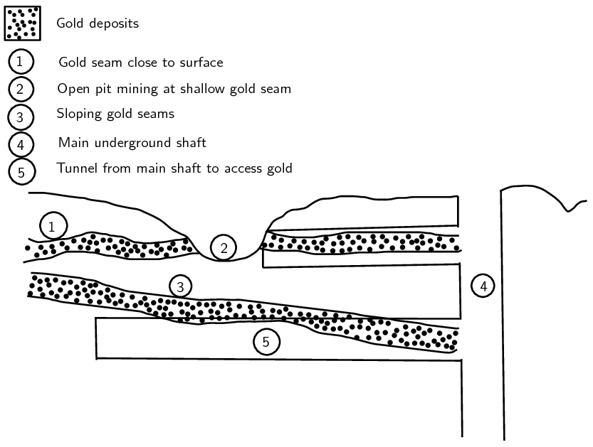
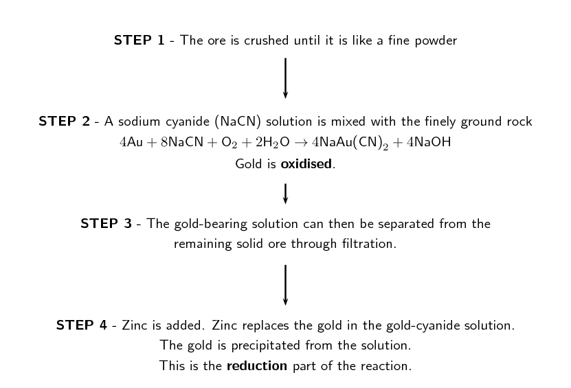
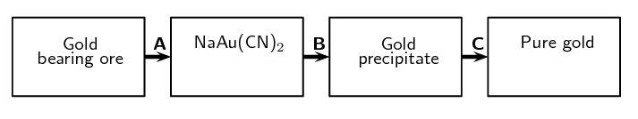

## 14.3 Mining and mineral processing (ESBRD)

Now that we know where the minerals that mankind uses can be found, we can look at how he accesses the minerals.
      We have seen that often the minerals are not found just lying around waiting to be picked up, but rather are
      embedded in rocks and combined with other elements.

As man learnt more and made new discoveries, the techniques used to extract the ores improved and the amount of
      mineral that could be extracted increased greatly. Large tunnels started to be cut into the Earth to access
      minerals buried deep underground. New processing methods meant new kinds of metals could be mined.

The main stages in mining are: exploration, extraction, refining, manufacturing and marketing. We will take a
      brief look at exploration, extraction and refining.

### Exploration (ESBRF)

Ancient humans did not worry about whether they could make money from the ores they mined. All they cared about
        was accessing metals and minerals that would help them eat, keep warm and beat the neighbouring tribes.

<Callout type="note" title="Note">
Indigenous people often have unique ways of finding mineral deposits, such as observing the behaviour of
          animals or noting the abundance of particular plants.
</Callout>

In modern times money matters and so the first step in mining is to find a suitably sized deposit of ore. For
        example, diamonds were found in Kimberley and gold ore was found in Johannesburg. These deposits were large
        enough to make mining for the gold and diamonds profitable.

As the number and size of known deposits is shrinking, geologists (who study the lithosphere) are developing
        new ways of finding suitable deposits. Geologists will often spend years learning how to find ores and then
        spend years exploring for the ores.

### Obtaining the ore (ESBRG)

Once a suitably sized deposit of a mineral has been found, mining can begin. In ancient times mining and
        mineral processing were very primitive and the main method used to extract ores was digging by hand.

Mining is largely divided into surface and underground mining. Minerals are often found in river beds, beach
        sands and other sandy areas. These are known as alluvial deposits. These minerals can be fairly easily removed
        by surface mining techniques. Other minerals occur in long streaks known as veins or in pipes, and underground
        mining techniques are used to access these minerals.

Surface mining includes open pit mines, quarrying, strip mining and landfill mining. Coal and copper are often
        mined in this way.

Underground mining mainly consists of digging tunnels and shafts into the Earth's crust. Gold is often mined in
        this way. Underground mining is more risky than surface mining as tunnels can collapse and dangerous gases build
        up underground.

We will look more at underground and surface mining shortly.

<Callout type="note" title="Note">
Coal miners used to take a canary with them down the mines. If the canary died, they knew that there was a
          high level of gas building up and that it was not safe to stay down in the mine.
</Callout>

### Extracting the minerals (ESBRH)

Once the ore has been mined it is usually crushed into smaller pieces that can be processed more easily. The
        mineral then needs to be removed from the ore.

Ancient peoples soon learnt that fire could be used to refine and purify the metals. This technique is known as
        smelting. This was the earliest method used to extract the mineral from the ore.

Smelting involves heating the ore to a very high temperature, often in a blast furnace. A reducing agent is
        usually added and the mineral is removed using chemical reactions.

In modern times several new techniques are used to extract the mineral from the ore, in addition to smelting.
        The most common methods are flotation, leaching and use of redox reactions.

Leaching involves mixing the ore with a carefully chosen liquid that dissolves either the mineral or the
        unwanted minerals. The liquid is often an acid.

Flotation involves the use of air bubbles to separate the valuable minerals from the unwanted rock. The
        valuable mineral becomes attached to the air bubbles and rises to the top of the mixture from where they can be
        removed.

The following table lists several metals and the typical methods used to mine and extract them.

| Metal | Mining techniques | Extraction techniques |
| --- | --- | --- |
| Gold | Underground mining (shaft mining) and surface mining. | Gold cyanidation is used. The ore is chemically treated to extract the gold. |
| Iron | Surface mining (open pit mining). | Smelting and chemical reduction. |
| Phosphate | Surface mining (open pit mining). | Treatment with acid. |
| Coal | Surface mining (open pit mining). Underground mining is now starting to become more common. | Coal is extracted in almost pure form. |
| Diamonds | Surface mining (alluvial deposits) and underground mining (pipe mining). | Diamonds are extracted from rocks and in almost pure form. |
| Copper | Surface mining (open pit mining). | Leaching is used to extract the copper using an acid. |
| Platinum | Underground mining (shaft mining). | Chemical methods and as a byproduct of copper mining. |
| Zinc | Underground mining (shaft mining). | Smelting and leaching. |
| Chromium (Chrome) | Surface mining (open pit mining) and underground mining (shaft mining). | Smelting, redox reactions. |
| Asbestos | Surface mining (open pit mining). | Extracted in fairly pure form. |
| Manganese | Surface mining (open pit mining) and underground mining (shaft mining). | Smelting and chemical processes. |

Table 14.3:
        Table showing the mining and mineral extraction techniques for several minerals.

We will now discuss gold mining in more detail to gain a better understanding of the mining process.

### Gold mining (ESBRJ)

Gold had long been known in Africa by the indigenous people, but in the late 1800's colonists found gold reefs
        and started exploiting the resource. Since then it has played a very important role (and often a controversial
        one too) in South Africa's *history* and *economy*. Its discovery brought many foreigners into
        South Africa, lured by the promises of wealth. They set up small mining villages which later grew into larger
        settlements, towns and cities. One of the first of these settlements was the beginning of present-day
        Johannesburg, also known as Egoli or Place of Gold.

Most of South Africa's gold is concentrated in the Golden Arc which stretches from Johannesburg to Welkom.
        Geologists believe that, millions of years ago, this area was a massive inland lake. Rivers feeding into this
        lake brought sand, silt, pebbles and fine particles of gold, depositing them over a long period of time.
        Eventually these deposits accumulated and became compacted to form gold-bearing sedimentary rock or **gold
          reefs**. It is because of this complex but unique set of circumstances that South Africa's gold
        deposits are so concentrated in that area. In other countries like Zimbabwe, gold occurs in smaller pockets
        which are scattered over a much greater area.

### Mining the gold (ESBRK)

A number of different techniques can be used to mine gold and other minerals. The three most common methods in
        South Africa are **panning**, **open pit** (not typically used for gold) and
        **shaft** mining.

2. **Panning**
   Panning for gold is a manual technique that is used to sort gold from other sediments. Wide, shallow pans
               are filled with sand and gravel (often from river beds) that may contain gold. Water is added and the pans
               are shaken so that the gold is sorted from the rock and other materials. Because gold is much more dense, it
               settles on the bottom of the pan. **Pilgrim's Rest** in Mpumalanga was the first site for gold
               panning in South Africa.
4. **Surface mining (open pit mining)**
   This type of mining takes place from the surface of the Earth. In open pit mining, the topsoil is removed
               first and placed on the side of a trench. Then the surface layers of rock are removed to expose the deeper,
               valuable mineral layers. The valuable rocks are then blasted into smaller rocks using explosives. The rocks
               are loaded onto huge trucks and taken away for further crushing and processing. Any mineral that is found
               close to the surface (even up to \(\text{1 000}\) \(\text{m}\)) can be mined using surface mining
               techniques. If minerals are found deeper, as is the case with most of the gold in South Africa, underground
               mining is used.
6. **Underground mining (shaft mining)**
   South Africa's thin but extensive gold reefs slope at an angle underneath the ground, and this means that
               some deposits are very deep and often difficult to reach. Shaft mining is needed to reach the gold ore.
               After the initial drilling, blasting and equipping of a mine shaft, tunnels are built leading outwards from
               the main shaft so that the gold reef can be reached. Shaft mining is a dangerous operation, and roof
               supports are needed so that the rock does not collapse. In addition the intense heat and high pressure below
               the surface make shaft mining very complex, dangerous and expensive. A diagram illustrating open cast and
               shaft mining is shown in Figure 14.3.
   
   Figure 14.3:
                 Diagram showing open pit and shaft mining.

### Processing the gold ore (ESBRM)

For every ton of ore that is mined, only a very small amount (about \(\text{5}\) \(\text{g}\)) of gold is
        extracted. A number of different methods can be used to separate gold from its ore, but one of the more common
        methods is called **gold cyanidation**.

In the process of gold cyanidation, the ore is crushed and then cyanide (\(\text{CN}^{-}\)) solution is added
        so that the gold particles are chemically separated from the ore. In this stage of the process, gold is
        oxidised. Zinc dust is then added to the cyanide solution. The zinc then takes the place of the gold, so that
        the gold is precipitated out of the solution. This process is shown in Figure 14.4.

Figure 14.4:
          Flow diagram showing how gold is processed.

### Characteristics and uses of gold (ESBRN)

Gold has a number of uses because of its varied and unique characteristics. Below is a list of some of these
        characteristics that have made gold such a valuable metal:

- *Shiny*
  Gold's beautiful appearance has made it one of the favourite metals for use in jewellery.
- *Durable*
  Gold does not tarnish or corrode easily, and therefore does not deteriorate in quality. It is sometimes
              used in dentistry to make the crowns for teeth.
- *Malleable and ductile*
  Gold can be bent and twisted into shape, as well as being flattened into very thin sheets. For this reason
              gold is used to make fine wires and thin, flat sheets.
- *Good conductor*
  Gold is a good conductor of electricity and is therefore used in transistors, computer circuits and
              telephone exchanges.
- *Heat ray reflector*
  Because gold reflects heat very effectively, it is used in space suits and in vehicles. It is also used in
              the protective outer coating of artificial satellites. One of the more unusual applications of gold is its
              use in firefighting, where a thin layer of gold is placed in the masks of the firefighters to protect them
              from the heat.

## Gold mining

### Textbook Exercise 14.1

In Mapungubwe (in the Limpopo Province) there is evidence of gold mining in South Africa as early as
              1200. Today, South Africa is a world leader in the technology of gold mining. The following flow diagram
              illustrates some of the most important steps in the recovery of gold from its ore.

**Problem:**
Name the process indicated by A.

**Solution:**
Oxidation of gold by sodium cyanide solution.

**Problem:**
During process A, gold is removed from the ore. Is gold oxidised or reduced during this process?

**Solution:**
Gold is oxidised.

**Problem:**
Use oxidation numbers to explain your answer to the question above.

**Solution:**
The equation for the reaction is:

              \[4\text{Au} + 8\text{NaCN} + \text{O}_{2} + 2\text{H}_{2}\text{O} \rightarrow 4\text{NaAu(CN)}_{2} +
              4\text{NaOH}\]

Refer to chapter 13, types of reactions to calculate oxidation numbers. In the reactants gold has an
                oxidation number of \(\text{0}\). In the products gold occurs as \(\text{NaAu}(\text{CN})_{2}\). The
                cyanide ion (\(\text{CN}^{-}\)) has an oxidation number of \(-\text{1}\). The sodium ion
                (\(\text{Na}^{+}\)) has an oxidation number of \(\text{+1}\). The overall compound must have a total
                oxidation number of \(\text{0}\). Let gold's oxidation number be \(x\). Then:

              \begin{align*}
              +1 + x + 2(-1) & = 0 \\
              x & = +1
              \end{align*}

So gold has an oxidation number of \(\text{+1}\) in the products. Since this is more positive (greater
                than) the oxidation number of gold in the reactants gold has lost electrons and so being oxidised.

**Problem:**
Name the chemical substance that is used in process B.

**Solution:**
Zinc

**Problem:**
During smelting (illustrated by C in the diagram), gold is sent to a large oven called a furnace. Why
                do you think this process is needed, and explain what happens to the gold during this process.

**Solution:**
The high temperature used during smelting causes the gold to become a liquid. This can then be removed
                from the molten mixture.

### Mining and the environment (ESBRP)

#### Environmental impacts of gold mining

However, despite the incredible value of gold and its usefulness in a variety of applications, all mining is
          undertaken at a cost to the environment. The following are just a few of the environmental impacts of gold
          mining:

- *Resource consumption*
  Gold mining consumes large amounts of electricity and water. Electricity is often generated using
                non-renewable resources.
- *Poisoned water*
  If the mining process is not monitored properly, acid and other chemicals from gold processing can leach
                into nearby water systems such as rivers. This causes damage to animals and plants, as well as to humans
                who may rely on that water for drinking.
- *Changing the landscape*
  This applies particularly to surface mines (open pit mines), where large amounts of soil and rock must be
                displaced in order to access the mineral reserves. The shape of the landscape can be changed when large
                amounts of rocks are dug up from the Earth and stacked on the surface. These are called mine dumps. Open
                pit mines also create very large holes (pits) in the ground that change the shape of the land.
- *Air pollution*
  Dust from open pit mines, as well as harmful gases such as sulphur dioxide and nitrogen dioxide, could be
                released from mining processes and contribute to air pollution.
- *Threaten natural areas*
  Mining activities often encroach on protected areas and threaten biodiversity in their operation areas.

## Mine rehabilitation

There is a growing emphasis on the need to rehabilitate old mine sites that are no longer in use. If it is
            too difficult to restore the site to what it was before, then a new type of land use might be decided for
            that area. Any mine rehabilitation programme should aim to achieve the following:

- ensure that the site is safe and stable
- remove pollutants that are contaminating the site
- restore the biodiversity that was there before mining started
- restore waterways to what they were before mining

There are different ways to achieve these goals. For example plants can be used to remove metals from
            polluted soils and water, and can also be used to stabilise the soil so that other vegetation can grow. Land
            contouring can help to restore drainage in the area.

*In groups of 3-4, discuss the following questions:*

2. What are the main benefits of mine rehabilitation?
4. What are some of the difficulties that may be experienced in trying to rehabilitate a mine site?
6. Suggest some creative ideas that could be used to encourage mining companies to rehabilitate old sites.
8. One rehabilitation project that has received a lot of publicity is the rehabilitation of dunes that
                   were mined for titanium by Richards Bay Minerals (RBM). As a group, carry out your own research to try
                   to find out more about this project.
   - What actions did RBM take to rehabilitate the dunes?
   - Was the project successful?
   - What were some of the challenges faced?

## Mining and Mapungubwe

Read the following information about Mapungubwe.

Because of the history preserved at the site, Mapungubwe was declared a National Heritage Site in the
            1980's and a World Heritage Site in 2003. The area surrounding it was declared a National Park in 1995.
            Unfortunately, the site is currently under huge threat from an Australian mining company who have been
            granted rights to construct an opencast and underground coal mine less than 6 km from the border of the
            National Park. There is much concern that mining operations will have a negative impact on the ecosystems,
            flora and fauna around Mapungubwe, and that it will hinder preservation of the site. Several environmental
            agencies have taken the matter to court in order to prohibit the planned mine and protect the environment
            around Mapungubwe.

As a class discuss, whether or not the proposed mining should go ahead. Divide into two teams. Assign one
            team to be in favour of the mining and one team against it. Each team should find facts relevant to their
            argument and then present it to the other team. At the end of the discussion, draw conclusions about whether
            or not the mining should take place.

<QuizCard id="s11-14-03b" title="Interactive Exercise 14.2" question="Identify one mining method used in South Africa." options=[] answer="2" hint="" explanation="Identify the mining method The three most common mining methods in South Africa are: panning , open pit mining (also known as open cast mining ), and shaft mining (also known as deep pit or underground mining ). Therefore the correct choice is: panning . Submit your answer as: panning" />

### Other minerals (ESBRQ)

We have largely focused on the process involved in mining gold. However gold is not the only mineral of
        interest to humankind. Many other minerals are useful such as copper, iron and platinum.

## Other mining activities

Choose one of the minerals given in the list below and find information on how that mineral is mined. Use the
          information given in this chapter about gold mining and try to find similar information for the mineral you
          have chosen. Write up your findings in a report. If possible, split the class into groups and assign a
          different mineral to each group.

- Iron
- Phosphate
- Coal
- Diamond
- Copper
- Platinum
- Zinc
- Chrome
- Asbestos
- Manganese
